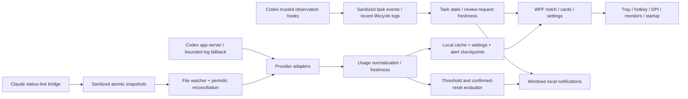

# Peak

A local Windows 10/11 overlay for personal AI subscription usage and Codex task activity. Built with C#/.NET 10 and WPF. No application database, remote usage backend, or telemetry. Peak is freeware with no activation, account or expiry. A rounded island rests at 360 × 42 DIPs, then smoothly stretches to 600 × 78 for confirmed work or attention requests. The expanded view uses inner information cards, remaining-usage bars, and a compact task activity footer inside one continuous outer shape. Dark, Light, System, and Custom themes are available. The custom Notch icon is embedded in the executable and used by its windows and system tray. Plain text provider names and Cx/Cl abbreviations identify the rings and cards. Third-party provider logos are not distributed.

## Run

Double-click **Launch Peak.cmd** or `dist/Peak/Peak.exe`. The published build includes its .NET runtime. Windows 10 version 2004 or later and Windows 11, x64, are supported by this build.

- Hover for details. Click the header to pin or collapse.
- Confirmed task activity widens the island automatically while keeping hover and click available. It shows the selected chat, current activity, elapsed time when its start was observed, and a count of other confirmed active chats. Review requests take priority and appear amber. Confirmed running tasks have an animated activity line. Unconfirmed local-log updates stay in the Tasks view and do not widen the idle pill or show a second activity row. Completion/interruption appears briefly before the idle island returns. A pinned details panel stays open. Windows' animation preference is respected.
- Escape or × collapses the panel.
- **Ctrl+Alt+U** or tray → **Show details** recovers a hidden, faded, or click-through notch. Settings → Shortcuts also offers Ctrl+Alt+P and Ctrl+Shift+Space; shortcut conflicts are reported after saving.
- Tray → **Settings** opens a neutral dark window with sidebar sections, rounded cards, segmented choices, and a live notch preview. Appearance, Providers, Alerts, Shortcuts, and System keep their controls together. Preferences apply with **Save changes**; color previews and connection actions have their own behavior described below.
- **Presence** offers Always, When active (confirmed work or brief completion), and On hover. Reported review requests can remain until cleared, appear for 10–300 seconds, or return for 8 seconds each minute after that initial period. Reports expire after five minutes without an update. Full-screen apps have separate Alerts only, Stay hidden, and Stay visible choices; a manual reveal pins readable details over any of these modes. Existing full-screen preferences migrate automatically.
- **Out of the way** can fade the notch under the pointer to any opacity, with Instant, Quick, or Soft transitions. Clicks pass through while fading; moving away restores it. Hold Alt while hovering to reveal and interact. Pinned details and reported attention stay readable, and On hover mode remains interactive. Windows' animation preference is respected.
- **Hide the notch from screen sharing** is optional and defaults off. It uses [Windows capture exclusion](https://learn.microsoft.com/en-us/windows/win32/api/winuser/nf-winuser-setwindowdisplayaffinity) for supported capture tools; recording applications can handle capture differently. Peak reports when Windows rejects the setting.
- **Settings → Appearance → Choose color…** opens a full saturation/brightness palette, hue slider, keyboard-accessible sliders, quick colors, and a hex field. Any opaque RGB color is supported, including white and black. The notch previews changes immediately. **Use color → Save** keeps the choice across restarts; canceling either dialog restores its previous appearance. Dark, Light, and System remain one-click alternatives. Primary text, secondary text, icons, and status labels maintain at least 4.5:1 contrast across the notch and its derived card/button surfaces, using [WCAG's sRGB contrast calculation](https://www.w3.org/WAI/WCAG22/Understanding/contrast-minimum.html). Status colors may become darker or lighter to stay readable.
- Tray → **Exit** shuts down the app and its child Codex process.
- **Preview Design.cmd** opens labeled sample readings without contacting providers. Exit the live app first; demo mode uses a separate local data directory. Demo mode never represents real quota usage.
- The expanded panel has **Limits** and **Tasks** views. The footer shows two recent tasks and small refresh/settings controls; click a task or Tasks/Review to see the full list. Task cards show chat names, project names, activity, and observation age. **Open chat** uses Codex's documented local-chat link; approvals are processed in Codex. Hover over reset countdowns for the exact local reset timestamp.

All percentages and bars in the UI show **remaining** usage. Alert thresholds use **consumed** usage. Each provider's compact percentage and ring show its current, confirmed **5-hour** limit. Weekly limits remain in the expanded details and still participate in alerts. If a provider supplies multiple 5-hour buckets, the most consumed fresh one is shown. Missing, expired, unverified, or stale 5-hour readings display a gray dash; a weekly reading does not substitute for them, and missing data is never treated as zero usage.

## Connect Codex

The app reads the documented native Codex `app-server` interface. It does not start model turns. Codex's Windows credential store is required; an existing file-based CLI login may not be visible to the notch.

1. In your user-level Codex `config.toml`, set `cli_auth_credentials_store = "keyring"`.
2. Run `codex login` yourself and complete the ChatGPT sign-in.
3. Enable Codex in Settings → Providers, then refresh the notch. New installations start with every provider disabled.

Alternatively, launch the CLI with a process-specific keyring override as documented by Codex. This app always applies `cli_auth_credentials_store="keyring"` to its child process and disables that process's analytics and OpenTelemetry exporter. It never reads, copies, migrates, or deletes `auth.json`, and never stores an API key or session token. Do not paste credentials into this app.

Native `codex.exe` discovery checks PATH, a bounded npm package location, and the Codex desktop app's bundled CLI location. Account quotas and reset timestamps come from `account/read` and `account/rateLimits/read`. Optional `account/usage/read` totals are activity, not a quota denominator. API-key billing is separate from ChatGPT subscription usage. New quota buckets are displayed independently; quota sizes are never hard-coded.

If the live interface fails, a bounded recent local-log fallback may show the last reported percentages. Its account identity is unverified, so those readings are excluded from the compact summary and alerts. No token-count-to-subscription-limit estimates are fabricated.

## Connect Codex task activity

Settings → **Connect task activity** adds Peak observer entries to the user-level `~/.codex/hooks.json`, preserving existing hooks. Connection changes apply immediately; Cancel discards other preferences only. In Codex, use **`/hooks`** to review and trust these definitions, then reconnect existing chats. Codex must support local hooks; disabled hooks, managed restrictions, remote machines, and cloud orchestration can prevent observations. The notch never grants hook trust or changes approval policies.

The bridge observes session, prompt, tool, permission-request, stop, and interruption events. It returns `{}` without an approval decision. Only chat/turn IDs, project leaf name, tool name, timestamps, and input fingerprints are saved. Prompts, commands, reasons, credentials, and outputs are discarded. Permission requests appear amber in task cards and the footer Review button. A request is evidence that approval was requested, not proof that a prompt is still pending: another hook may decide it. Completion, interruption, or later turn events clear it; after five minutes without evidence, active/requested states become unknown. Concurrent tool completions clear only matching requests. Optional review notifications default off.

Without trusted hook events, recent local logs provide activity, finished-turn observations, and pending `request_user_input` questions. Questions appear as “Question for you” in the island and task cards; only the matching tool result, a later turn, or completion/interruption clears them. Local questions follow the same five-minute observation expiry. The UI still says approval monitoring needs setup: missing approval data never means “no approvals.” Stored `thread/list` names are read without resuming chats; a separate app-server's runtime `notLoaded` state is deliberately ignored. Refresh reconciles events every five seconds, with file watchers for hook and local-session changes and a one-minute metadata refresh. Bounded log tails are cached as lifecycle metadata and hashed question call IDs only; question text and answers are discarded. Chat titles remain in memory.

**Disconnect** removes only the notch's observer entries and preserves unrelated hooks. Reconnect existing chats to stop hooks already loaded there. Full approval details and running command arguments stay in Codex; this version shows the tool category rather than storing potentially secret command text.

## Connect Claude

In Settings, click **Connect Claude**, enable Claude, and save. Restart Claude Code and use it once. The bridge writes only quota percentages, reset timestamps, CLI version, a hashed activity fingerprint, and a local observation timestamp. It keeps the existing status-line command's output and restores that command on Disconnect, unless you have since changed it yourself. Connect/Disconnect applies immediately; Cancel only discards the other settings fields.

The published bridge is copied to `%LOCALAPPDATA%/UsageNotch/bridge` so the CLI command has a stable path. Setup changes only the user-level `statusLine` entry in Claude's settings, saving only its previous value. Unrelated settings are preserved, although JSON formatting/comments are normalized. If a project-specific status line overrides the user setting, it must be adjusted manually.

This uses Claude Code's documented `rate_limits.five_hour` and `rate_limits.seven_day` status-line fields. Current documentation requires **Claude Code 2.1.251+**, a supported subscription, and an initial API response. Older CLIs or unsupported plans can omit these fields. Older Claude CLI versions need updating before quota data can be verified live.

Claude readings update during CLI activity. Repeated identical redraws do not refresh the observation timestamp. After five minutes they are marked stale. Expired windows say “Awaiting provider update”; the app never assumes a reset means 0% usage. The personal-account binding is an explicit v1 assumption: status-line input does not identify the account. Disable/reconnect Claude after switching accounts; multiple accounts are not supported yet.

## Local storage and privacy

Files are under `%LOCALAPPDATA%/UsageNotch`:

Peak preserves this legacy data location, observer identifiers, and single-instance signals so existing settings, caches, and Claude/Codex connections continue to work after the rename. The executable, windows, tray label, notifications, launch script, new startup entry, Start-menu installation shortcut, and future test packages use Peak. See [the name check](docs/Peak-name-check.md).

- `settings.json`: non-secret preferences.
- `usage-cache.json`: latest normalized readings; account email labels are omitted from persisted cache.
- `alert-state.json`: hashed account/window keys and delivered thresholds for deduplication.
- `claude/*.json`: sanitized Claude observations, with hashed session filenames.
- `bridge/setup.json`: the installed command and a DPAPI-encrypted backup of the previous status-line entry, readable only by your Windows user.
- `codex-tasks/*.jsonl`: sanitized local Codex lifecycle observations; bounded recent tails are read for display.
- `task-bridge/`: the local observer executable installed by Connect task activity. No credentials are stored there.
- `startup-error.txt`: startup timestamp and fault category only; expires after seven days during maintenance.
- Legacy `license.dat`: ignored by freeware; preserved until explicit complete local-data deletion.
- `integrations.json`: local provider configuration paths for reliable disconnection/uninstall.

Provider CLI processes can make authenticated requests to their provider. Peak has no remote usage backend, telemetry, cookies, payment integration or unofficial provider web endpoint integration. Notification preferences default off. First readings are seeded silently; subsequent threshold crossings are deduplicated per account/window/cycle. Reset notifications require a later provider timestamp and lower usage after the previous reset time, rather than timer expiry alone.

## Build, test, publish

Install .NET 10 SDK. Run from this directory:

```powershell
./scripts/verify.ps1
./scripts/publish.ps1
```

`publish.ps1` produces a self-contained `dist/Peak` directory. `-FrameworkDependent` produces a smaller build requiring the .NET 10 Desktop Runtime. `scripts/install-user.ps1` installs the published files for the current user and adds a Start-menu shortcut, without administrator access. Exit the app before replacing its binaries. Native AOT for the console bridge is an optional future size optimization, requiring the Windows C++ toolchain; it is not needed to run this build.

For a friend test, run `./scripts/package-test.ps1 -Tag 2026-10-01` after publishing. It creates a Windows x64 ZIP and SHA-256 sidecar under `artifacts/releases`, using published binaries and runtime metadata only, without debug symbols or personal settings. The ZIP includes [the friend setup guide](docs/Friend-test-guide.md), dependency notices, and file checksums. Keep the complete extracted folder together. Claude usage is supported; Claude task/approval monitoring is not implemented yet, so the guide explicitly distinguishes the available features.

The expanded limits and task views share one outer outline. The header has a straight bottom edge while expanded, and the content has no second rounded outer panel; the collapsed pill and inner information cards retain their rounded corners.

Developer inspection: start the executable with `--inspect` to keep it visible over full-screen apps and expose a taskbar window for UI tooling. The normal app has no taskbar entry. `--demo` also enables that inspection behavior and uses isolated data. Do not enable launch-on-startup in inspection/demo mode.

`--demo --demo-cycle` repeats idle, working, review and finished sample states for checking the island animations without contacting providers. Task progress is an activity indicator; the current task sources do not report a completion percentage. Elapsed time includes waiting, and an unobserved start is shown as observation age instead.

## Freeware and privacy

Peak is free for personal and workplace use on unlimited devices. No Peak account, payment, activation or expiry. Normal startup uses the providers you enable; sample data requires `--demo`. Provider subscriptions are separate. Source ownership is retained; freeware redistribution terms apply to complete unchanged official packages.

Publisher: **neorangel**. Support: **peakforwindows.support@gmail.com**. Website: https://peakforwindows.vercel.app. Public binaries: https://github.com/shirokuuun/Peak-releases/releases. The application source repository stays private.

Settings → **About & Support** shows the version, contact, downloads and policy links. **Privacy** manages provider consent, disconnection and owned observations. Clearing observations preserves preferences and restoration backups. Original provider logs are never deleted. Owned task events and Claude snapshots are pruned after seven days, capped at 10 MiB per folder; task files are capped at 512 KiB. Providers start disabled and migration preserves preferences while asking for consent.

Public contact details are in `src/UsageNotch.App/publishing.json`. Blank details are allowed for development and do not restrict monitoring, but block public packaging. Old paid-license data is ignored, remains until explicit complete local deletion, and triggers no merchant requests. There is no payment integration in the build.

See [public release instructions](docs/Public-release.md), [release checklist](docs/Release-checklist.md), and the user guide in [Download-README](docs/Download-README.md). Installer and portable packages include the runtime, bridge, complete notices and matching policy version 1.0. Updates are manual. The first release is explicitly unsigned and the download page explains Windows warnings.

## Architecture



`UsageNotch.Core` contains provider-neutral records and alert/freshness rules. `UsageNotch.Providers` owns data parsing and CLI processes. `UsageNotch.Windows` owns platform operations and local persistence. `UsageNotch.App` contains the WPF views and polling state. `UsageNotch.ClaudeBridge` is the sanitized CLI bridge. Implement `IUsageProvider`, and optionally `IUsageChangeSource`, to add providers; add explicit settings and card naming for the new provider.

## Verification and limits

The release verification runs provider, privacy and freeware tests. These cover quota mapping and freshness, notification deduplication, Claude bridge setup/privacy, task observer sanitization, concurrent approvals, new-turn/late-event ordering, request expiration, local question detection and matching answers without hooks, sanitized question-cache round trips, local-session watcher updates, question/hook reconciliation, local-log limitations, catalog naming, hook install/remove preservation, the real Windows observer command with spaces and Unicode, island task priority and stability, unconfirmed activity staying compact, completion/expiry transitions, observed start timestamps, palette contrast, presence modes, reminder timing, full-screen priorities, pointer fading, recovery, legacy preference migration, preference serialization, and compact 5-hour selection without a weekly fallback. Native UI checks cover startup, expansion, hotkey recovery, settings, and the task preview. Real quota and hook observations must also be compared with Codex after secure login and hook trust; live Claude quotas require a CLI update.

Transparent WPF windows, hotkey conflicts, mixed-DPI monitors, monitor hot-plugging, sleep/lock, and Windows notification suppression need further testing on additional machines. The app positions in physical pixels and reacts to DPI/display changes; an unavailable chosen monitor falls back to primary. The default top gap is 12 WPF pixels, scaled to the monitor's DPI and measured from the work area's top edge, respecting a top-docked taskbar. **Gap from top** in Settings remains adjustable from 0 to 200. The gap stays fixed while the notch expands downward. The refresh loop is single-flight with a 30-second total timeout and bounded failure backoff. Polling pauses during sleep/lock and refreshes on resume/unlock. Clock display is UTC-based and rendered in local time; it does not decrement saved timestamps or invent quota resets.

The first freeware release is unsigned. Per-user installation and an optional signing pipeline are implemented. Additional clean-machine testing and a trusted publisher certificate remain follow-up work. Microsoft Store/MSIX, trusted automatic updates, ARM64 builds, long-term charts, multiple accounts, and more providers remain follow-up work. Automatic update downloads are intentionally absent until a trusted release feed and signing identity are chosen. Windows toasts use the small Community Toolkit desktop compatibility package; Microsoft now recommends Windows App SDK notifications for new apps, which is a packaging/runtime tradeoff to revisit before wider distribution.

## Provider references (checked September 30, 2026)

- [Codex app-server](https://learn.chatgpt.com/docs/app-server)
- [Codex lifecycle hooks and trust](https://learn.chatgpt.com/docs/hooks)
- [Codex local chat links](https://learn.chatgpt.com/docs/reference/commands)
- [Codex authentication and credential stores](https://learn.chatgpt.com/docs/auth)
- [Codex configuration reference](https://learn.chatgpt.com/docs/config-file/config-reference)
- [Claude Code status-line fields](https://code.claude.com/docs/en/statusline)
- [Windows notifications overview](https://learn.microsoft.com/en-us/windows/apps/develop/notifications/)

These client interfaces and plan entitlements can change. Verify your CLI version and compare both percentages and reset times with its own usage display. No public personal-subscription usage API is assumed for Claude, and local token totals alone cannot establish a subscription percentage.
